# Review sheet — test — adv_hrr_view

For each question: read the agent's answer, open the crops (they are cut from the original PDF page, not from extracted text), compare with the expected answer, then write `pass` or `fail` in `test_adv_hrr_view_labels.csv` → column `student_label` (and a note if you disagree with the draft).

## adv-t01 · table · draft label: **PASS**

**Question:** Among the largest American unions in 2021, which union ranks fourth by membership, and how many members does it have?

**Expected:** AFSCME (American Federation of State, County, and Municipal Workers) with 1.6 million members. (NEA 3.0M, SEIU 2.0M, AFT 1.7M, AFSCME 1.6M; the Teamsters, listed fourth in the table, have only 1.4M.)

**Agent (answered):** The fourth-largest union by membership in 2021 is the American Federation of State, County, and Municipal Workers (AFSCME), with 1.6 million members. The ranking follows the membership figures: NEA 3.0 million, SEIU 2.0 million, AFT 1.7 million, AFSCME 1.6 million, then IBT 1.4 million. The table prints the Teamsters (1.4 million) above AFSCME, but the figures show AFSCME is larger [p0346-tab14.6].

**Draft reason:** AFSCME 1.6 million is 4th by value (NEA 3.0, SEIU 2.0, AFT 1.7, AFSCME 1.6, IBT 1.4); agent explicitly notices the table prints IBT above AFSCME. Table 14.6 p.346 viewed and cited.

*cited: `p0346-tab14.6` — table Table 14.6 — PDF page 346 (printed 334)*

---

## adv-t02 · table · draft label: **PASS**

**Question:** In 2020, how many percentage points higher was the poverty rate for females than for males?

**Expected:** 2.4 percentage points (females 12.6%, males 10.2%).

**Agent (answered):** In 2020, the poverty rate was 12.6% for females and 10.2% for males, so the female rate was 12.6 - 10.2 = 2.4 percentage points higher [p0371-tab15.1].

**Draft reason:** 12.6% - 10.2% = 2.4 points; Table 15.1 p.371 viewed and cited.

*cited: `p0371-tab15.1` — table Table 15.1 — PDF page 371 (printed 359)*

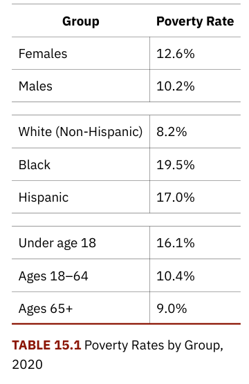

---

## adv-t03 · table · draft label: **PASS**

**Question:** In the 2020 international comparison of health care spending, how much more did the United States spend per person than Germany, and what was U.S. female life expectancy at birth?

**Expected:** $4,217 more ($10,948 vs $6,731); U.S. female life expectancy 80.2 years.

**Agent (answered):** In 2020, the United States spent $10,948 per person on health care versus $6,731 in Germany, so the U.S. spent $10,948 − $6,731 = $4,217 more per person. U.S. female life expectancy at birth was 80.2 years. [p0409-tab16.2]

**Draft reason:** $10,948 - $6,731 = $4,217; female life expectancy 80.2 (correct column, not male 75.5); Table 16.2 p.409 viewed and cited.

*cited: `p0409-tab16.2` — table Table 16.2 — PDF page 409 (printed 397)*

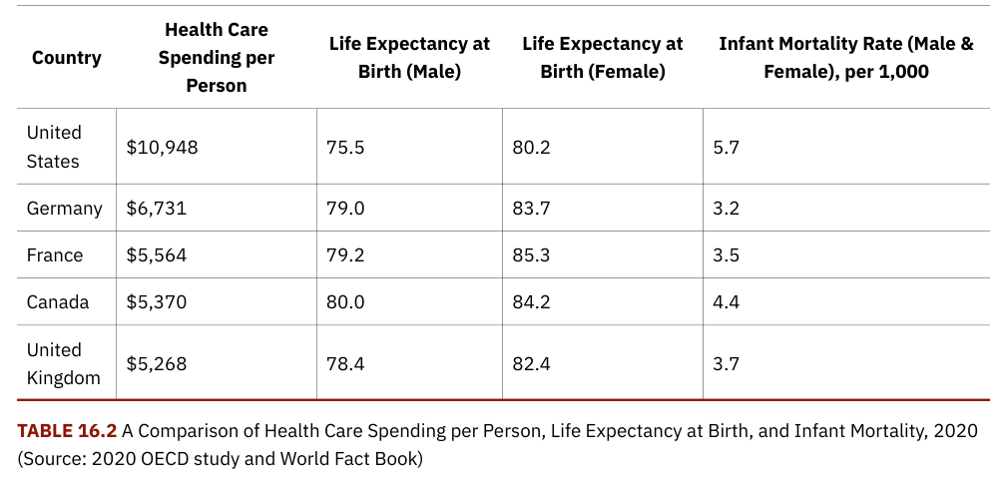

---

## adv-t04 · table · draft label: **PASS**

**Question:** In the table of annual returns on S&P 500 stocks, which period had a negative total annual return, and what were its capital gains and dividends components?

**Expected:** 2000-2009: total annual return -1.00%, capital gains -2.70%, dividends 1.70%.

**Agent (answered):** The only period with a negative total annual return was 2000–2009, at −1.00%. Its components were capital gains of −2.70% and dividends of 1.70% (−2.70% + 1.70% ≈ −1.00%). [p0430-tab17.2]

**Draft reason:** 2000-2009: -1.00% total, -2.70% capital gains, 1.70% dividends; Table 17.2 p.430 viewed and cited.

*cited: `p0430-tab17.2` — table Table 17.2 — PDF page 430 (printed 418)*

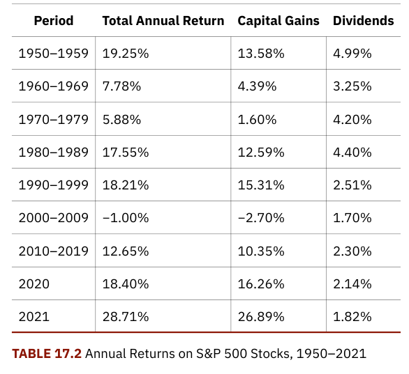

---

## adv-t05 · table · draft label: **PASS**

**Question:** Which industry protected by import tariffs or quotas has the highest annual cost to U.S. consumers per job saved, and how much higher is that cost than for dairy products?

**Expected:** Sugar, $826,000 per job saved; $141,000 more than dairy products ($685,000).

**Agent (answered):** Sugar has the highest annual cost to U.S. consumers per job saved among the industries listed, at $826,000 per job. Dairy products cost $685,000 per job saved, so sugar's cost is $826,000 − $685,000 = $141,000 higher (about 1.21 times the dairy figure). [p0490-tab20.2]

**Draft reason:** Sugar $826,000; $826,000 - $685,000 = $141,000; Table 20.2 p.490 viewed and cited. Extra ratio 1.21x is correct arithmetic.

*cited: `p0490-tab20.2` — table Table 20.2 — PDF page 490 (printed 478)*

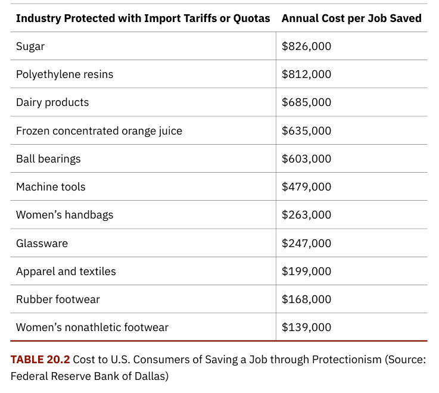

---

## adv-t06 · table · draft label: **PASS**

**Question:** In 2018, how much U.S. research and development funding came from industry, and what percentage of total R&D funding was that?

**Expected:** $426.0 billion, 70.3% of the $606.1 billion total.

**Agent (answered):** In 2018, industry provided $426.0 billion of U.S. R&D funding, which was 70.3% of the $606.1 billion total [p0325-tab13.3]. The accompanying text describes this share as "about 69%" [p0325-t0], so the table's 70.3% is the more precise figure.

**Draft reason:** $426.0 billion, 70.3% of $606.1 billion (Table 13.3 p.325); extra remark that the text says 'about 69%' is supported by cited p0325-t0.

*cited: `p0325-tab13.3` — table Table 13.3 — PDF page 325 (printed 313)*

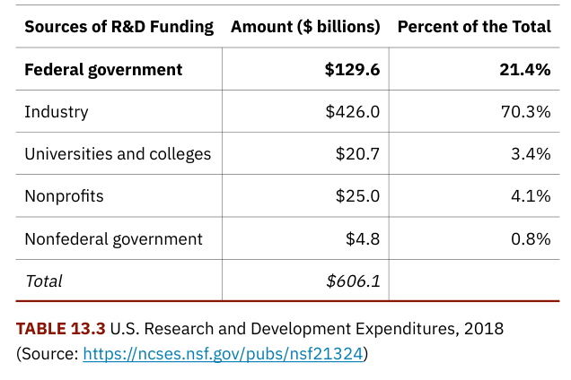

*cited: `p0325-t0` — text  — PDF page 325 (printed 313)*

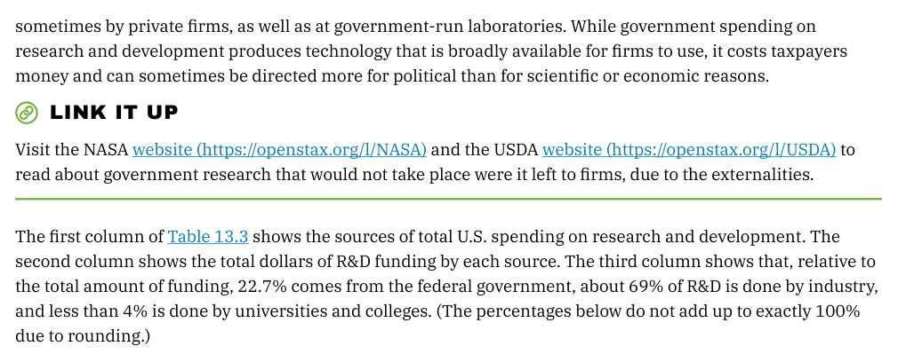

---

## adv-t07 · diagram · draft label: **PASS**

**Question:** In the circular flow diagram, which two labeled flows go from households to firms?

**Expected:** B: Payment for goods and services, and C: Labor services.

**Agent (answered):** The two labeled flows from households to firms are B: Payment for Goods and Services (outer lower arc) and C: Labor Services (inner lower arc). The other two flows, A (Goods and Services) and D (Wages, Salaries and Benefits), run from firms to households [p0029-fig1.7].

**Draft reason:** B (Payment for Goods and Services) and C (Labor Services) point to Firms in Figure 1.7 p.29 (viewed); A and D correctly placed as firms-to-households.

*cited: `p0029-fig1.7` — figure Figure 1.7 — PDF page 29 (printed 17)*

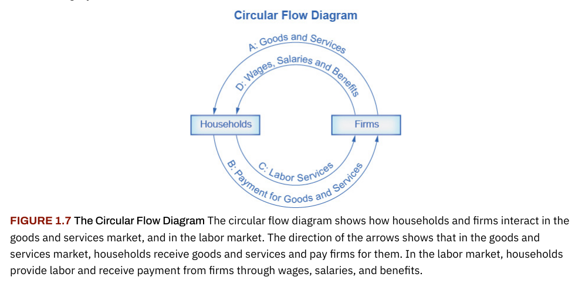

---

## adv-t08 · diagram · draft label: **PASS**

**Question:** In the pollution charge diagram, what is the marginal cost of reducing particle emissions by 30 pounds and by 40 pounds, and by how much will the firm reduce emissions when the charge is $1,000?

**Expected:** $900 at 30 pounds and $1,500 at 40 pounds; with a $1,000 charge the firm reduces emissions by 30 pounds.

**Agent (answered):** The marginal cost of reducing particle emissions is $900 at 30 pounds and about $1,500 at 40 pounds. With a $1,000 pollution charge, the firm will reduce emissions by about 30 pounds, since that reduction costs $900, less than the charge, while a 40-pound reduction costs about $1,500, more than the charge. The marginal cost curve crosses the $1,000 charge just past 30 pounds, so 30 pounds is the reduction the figure identifies. [p0297-fig12.3]

**Draft reason:** $900 at 30 lb, ~$1,500 at 40 lb (point on the curve), reduce 30 lb with a $1,000 charge; Figure 12.3 p.297 viewed and cited.

*cited: `p0297-fig12.3` — figure Figure 12.3 — PDF page 297 (printed 285)*

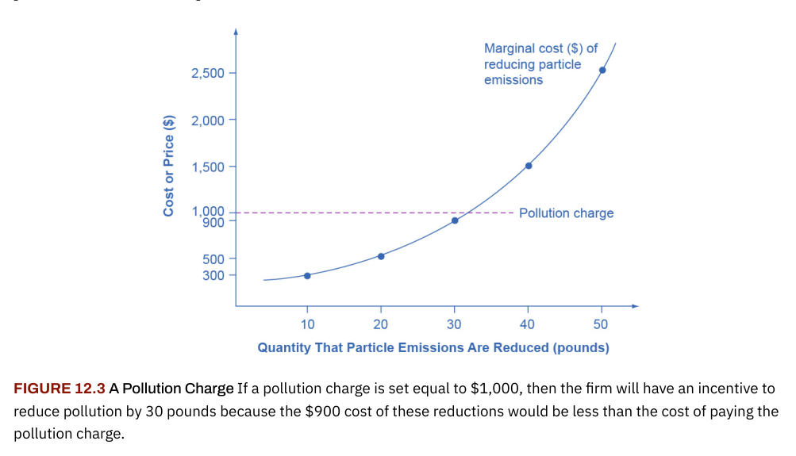

---

## adv-t09 · diagram · draft label: **PASS**

**Question:** According to the diagram of what comes into and goes out of an insurance company, what are the sources of money coming in and the uses of money going out?

**Expected:** Money in: premiums from customers and investment income. Money out: payments to customers, expenses, and profits or losses.

**Agent (answered):** Money coming in: premiums from customers and investment income. Money going out: payments to customers (claims), expenses, and profits or losses. The caption adds that money flows in through premiums and investments and out through claim payments and operating expenses. [p0405-fig16.2]

**Draft reason:** In: premiums from customers, investment income; out: payments to customers, expenses, profits or losses (Figure 16.2 p.405, viewed). Caption paraphrase added is also correct.

*cited: `p0405-fig16.2` — figure Figure 16.2 — PDF page 405 (printed 393)*

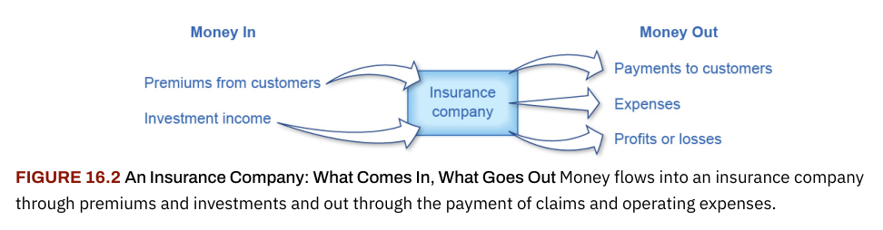

---

## adv-t10 · diagram · draft label: **PASS**

**Question:** In the diagrams of the sugar trade between Brazil and the United States, what is the price of sugar with no trade in Brazil and in the United States?

**Expected:** Brazil: 12 cents per pound; United States: 24 cents per pound.

**Agent (answered):** With no trade, sugar sells for 12 cents per pound in Brazil and 24 cents per pound in the United States. [p0484-fig20.2]

**Draft reason:** No-trade price 12 cents (Brazil) and 24 cents (U.S.); Figure 20.2 p.484 viewed and cited.

*cited: `p0484-fig20.2` — figure Figure 20.2 — PDF page 484 (printed 472)*

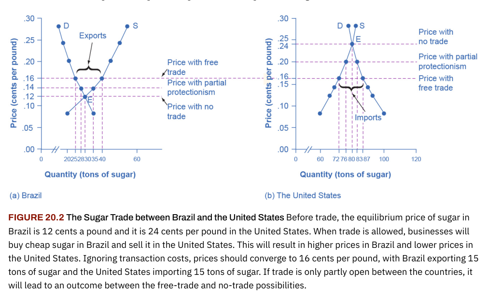

*gold: `p0484-tab20.1` — table Table 20.1 — PDF page 484 (printed 472)*

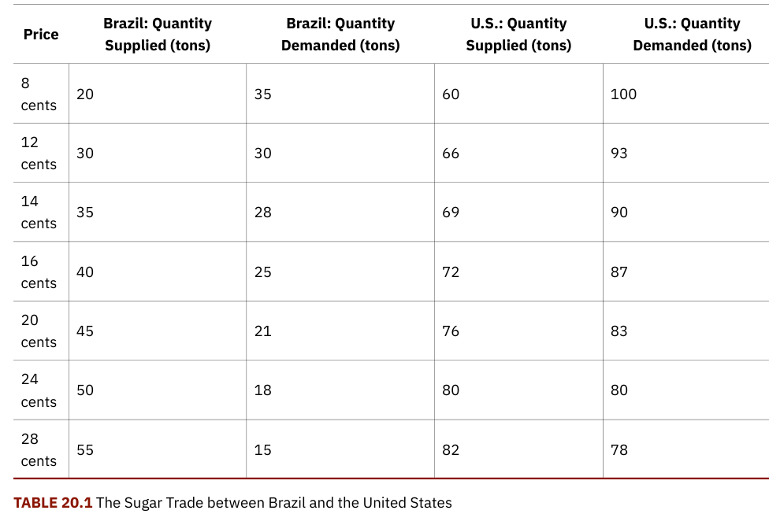

---

## adv-t11 · diagram · draft label: **PASS**

**Question:** In the voting cycle diagram about choosing a dish, which option beats which, and by what vote?

**Expected:** Lasagna beats turkey 2-1, roast beef beats lasagna 2-1, and turkey beats roast beef 2-1, so the votes form a cycle with no majority winner.

**Agent (answered):** The voting cycle in Figure 18.2 shows three pairwise majority votes, each won 2–1: Turkey beats roast beef (2–1) [p0453-fig18.2], roast beef beats lasagna (2–1) [p0453-fig18.2], and lasagna beats turkey (2–1) [p0453-fig18.2]. Because each option loses to another, the arrows form a loop with no clear winner [p0453-fig18.2].

**Draft reason:** All three 2-1 pairwise results and the cycle; Figure 18.2 p.453 viewed and cited.

*cited: `p0453-fig18.2` — figure Figure 18.2 — PDF page 453 (printed 441)*

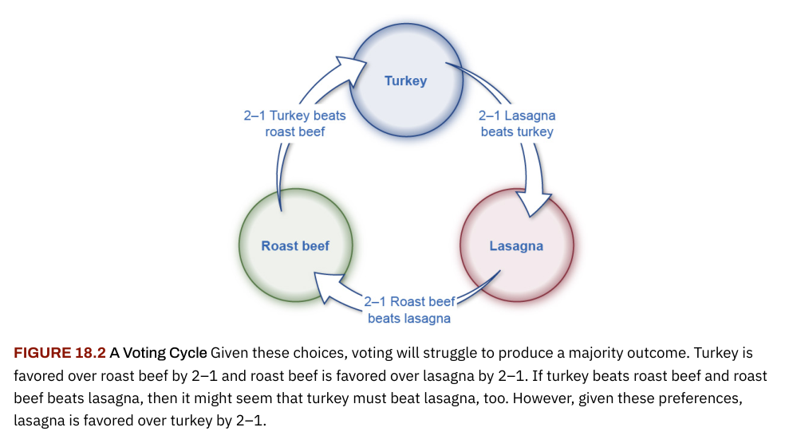

---

## adv-t12 · chart · draft label: **PASS**

**Question:** According to the chart of mergers submitted for review by the Federal Trade Commission from 1999 to 2012, in which year were the fewest mergers submitted and how many, and which year had the most?

**Expected:** Fewest in 2009 with 716; most in 2000 with 4,926.

**Agent (answered):** The fewest mergers submitted for FTC review were in 2009, with 716. The most were in 2000, with 4,926 (slightly above 1999's 4,642). [p0273-fig11.2]

**Draft reason:** Fewest 2009 (716), most 2000 (4,926) from bar labels of Figure 11.2(a) p.273 (viewed); 1999 4,642 also correct.

*cited: `p0273-fig11.2` — figure Figure 11.2 — PDF page 273 (printed 261)*

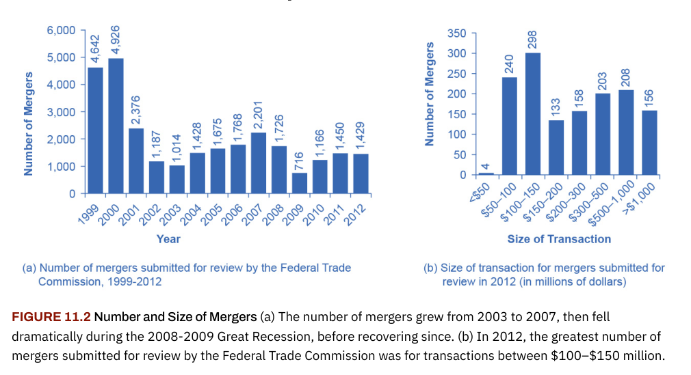

---

## adv-t13 · chart · draft label: **PASS**

**Question:** According to the 2012 chart of earnings and unemployment by education, how much higher were median weekly earnings with a master's degree than with a bachelor's degree, and what were the two unemployment rates?

**Expected:** $234 more per week ($1,300 vs $1,066); unemployment 3.5% (master's) vs 4.5% (bachelor's).

**Agent (answered):** Median weekly earnings with a master's degree were $234 higher than with a bachelor's degree: $1,300 - $1,066 = $234. The unemployment rate was 3.5% for master's degree holders and 4.5% for bachelor's degree holders in 2012. [p0163-fig6.6]

**Draft reason:** $1,300 - $1,066 = $234; 3.5% vs 4.5%; Figure 6.6 p.163 viewed and cited.

*cited: `p0163-fig6.6` — figure Figure 6.6 — PDF page 163 (printed 151)*

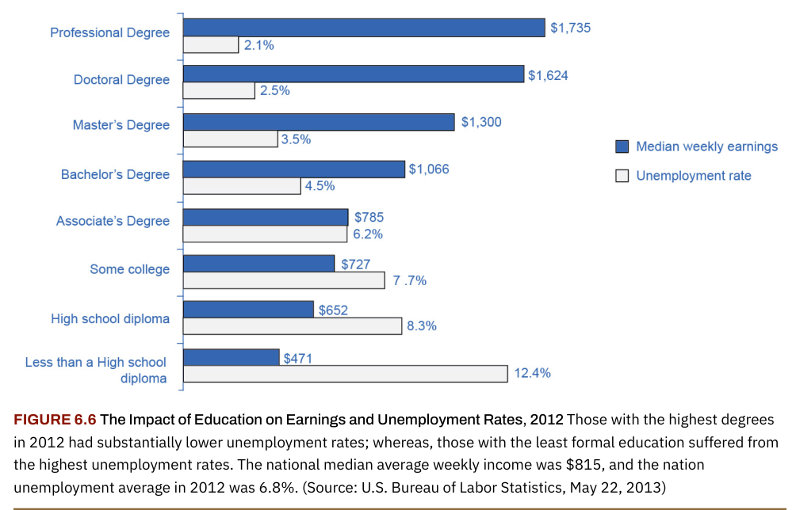

---

## adv-t14 · chart · draft label: **PASS**

**Question:** According to the chart of immigration to the United States since 1900, which decade had the most immigrants and roughly how many, and which decade had the fewest?

**Expected:** Most in 2000-2009, about 11.4 million (accept 11.0-11.7 million); fewest in 1930-1939 (under 1 million, about 0.7 million).

**Tolerance:** max decade value in [11.0M, 11.7M]

**Agent (answered):** The 2000 to 2009 decade had the most immigrants, roughly 11.4 million (read from the bar, so approximate) [p0360-fig14.17]. The 1930 to 1939 decade had the fewest, roughly 1 million [p0360-fig14.17]. The 2010 to 2019 bar is about the same height as 2000 to 2009, just slightly lower [p0360-fig14.17].

**Draft reason:** Most 2000-2009 at ~11.4 million (in tolerance); fewest 1930-1939. It calls the 1930s bar 'roughly 1 million' (the bar is ~0.7 million, below the 2,000,000 tick) - the size of the smallest bar was not asked; flagged for review.

*cited: `p0360-fig14.17` — figure Figure 14.17 — PDF page 360 (printed 348)*

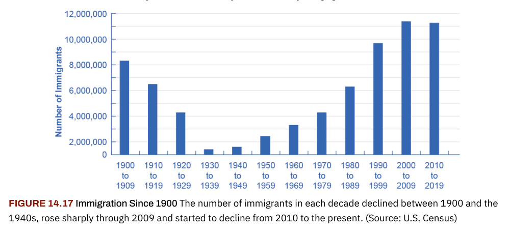

---

## adv-t15 · chart · draft label: **PASS**

**Question:** In the chart of patents filed and granted from 1990 to 2020, in which year were the most patent applications filed, and approximately how many?

**Expected:** 2019, about 670,000 applications filed (accept 650,000-690,000); about 390,000 were granted that year.

**Tolerance:** filed in [650k, 690k]

**Agent (answered):** Patent applications filed were highest in 2019, at roughly 665,000 to 670,000 (about 665,000 by visual estimate from the bar height against the 600,000 and 700,000 gridlines). The chart has no data labels, so this is an approximate reading [p0324-fig13.4]. Filings dipped slightly to about 645,000 in 2020 [p0324-fig13.4].

**Draft reason:** 2019, ~665,000-670,000 filed (in tolerance); 2020 ~645,000 also matches the chart. Figure 13.4 p.324 viewed and cited.

*cited: `p0324-fig13.4` — figure Figure 13.4 — PDF page 324 (printed 312)*

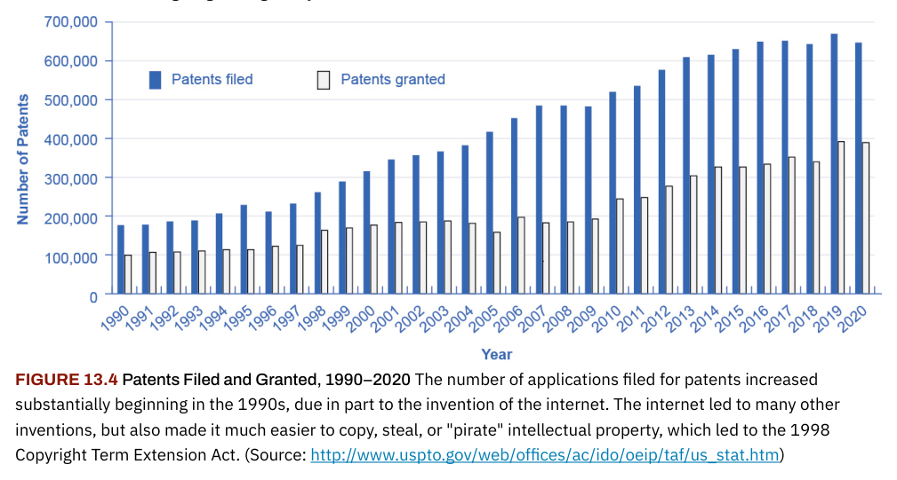

---

## adv-t16 · chart · draft label: **PASS**

**Question:** In the chart of wage ratios by sex and race, which ratio was higher at the end of the data (around 2015), and approximately what were the two values?

**Expected:** Female-to-male was higher, about 79-80%; Black-to-white was about 73%. (The lines crossed in the early 2000s.)

**Tolerance:** female-to-male in [77, 81]; Black-to-white in [71, 75]

**Agent (answered):** At the end of the data (about 2015), the female-to-male wage ratio was higher. It was roughly 79–80%, compared with roughly 73–74% for the Black-to-White wage ratio. These are approximate readings from the chart's axis, since it has no data labels [p0354-fig14.15].

**Draft reason:** Female-to-male higher at ~79-80%, Black-to-white ~73-74% (both in tolerance); Figure 14.15 p.354 viewed and cited.

*cited: `p0354-fig14.15` — figure Figure 14.15 — PDF page 354 (printed 342)*

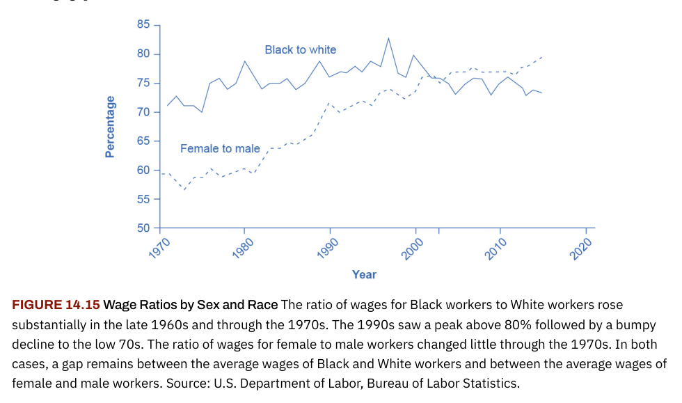

---

## adv-t17 · multihop · draft label: **PASS**

**Question:** Based on the hours needed to produce oil and corn in Saudi Arabia and the United States, which country has the comparative advantage in corn, and what is its opportunity cost of one bushel of corn in terms of oil?

**Expected:** The United States (1 hour per bushel of corn vs 2 hours per barrel of oil); its opportunity cost of one bushel of corn is 1/2 barrel of oil (Saudi Arabia's is 4 barrels).

**Agent (answered):** The United States has the comparative advantage in corn. Producing one bushel of corn takes the U.S. 1 hour versus 4 hours in Saudi Arabia, so the U.S. gives up less oil per bushel. The U.S. opportunity cost of one bushel of corn is one-half barrel of oil (Table 19.4 shows ½ for the U.S. corn entry, and the U.S. needs 1 hour for corn versus 2 hours for a barrel of oil). [p0462-tab19.1] [p0463-tab19.4]</answer>
<parameter name="citations">["p0462-tab19.1", "p0463-tab19.4"]

**Draft reason:** U.S. has comparative advantage in corn (1 h vs 4 h), opportunity cost 1/2 barrel of oil; Table 19.1 p.462 and Table 19.4 p.463 cited (19.4 viewed). Answer string ends with leaked '</answer><parameter ...>' markup (formatting glitch, no extra claim).

*cited: `p0462-tab19.1` — table Table 19.1 — PDF page 462 (printed 450)*

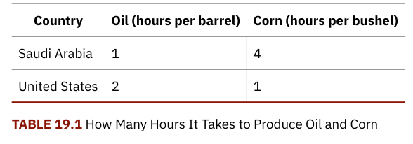

*cited: `p0463-tab19.4` — table Table 19.4 — PDF page 463 (printed 451)*

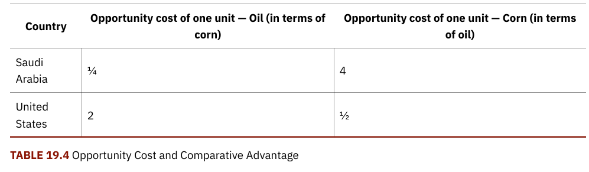

---

## adv-t18 · multihop · draft label: **PASS**

**Question:** Approximately what was the peak share of U.S. wage and salary workers who were union members, when was it, and what was U.S. union density in 2012 according to the international comparison table?

**Expected:** Peak of roughly 28% (accept 27-29%) in the mid-1950s (Figure 14.11); U.S. union density in 2012 was 11.1% (Table 14.8), with union coverage 12.5%.

**Tolerance:** peak in [27, 29]%

**Agent (answered):** The share of U.S. wage and salary workers who were union members peaked at roughly 28–29% in about 1955 (the figure has no data labels, so this is an approximate reading from the chart) [p0347-fig14.11]. In the international comparison table (Table 14.8, 2012 data from the CIA World Factbook), U.S. union density was 11.1% [p0351-tab14.8].

**Draft reason:** Peak ~28-29% about 1955 (Figure 14.11 p.347, viewed; within 27-29 tolerance) and 11.1% U.S. union density 2012 (Table 14.8 p.351, viewed).

*cited: `p0347-fig14.11` — figure Figure 14.11 — PDF page 347 (printed 335)*

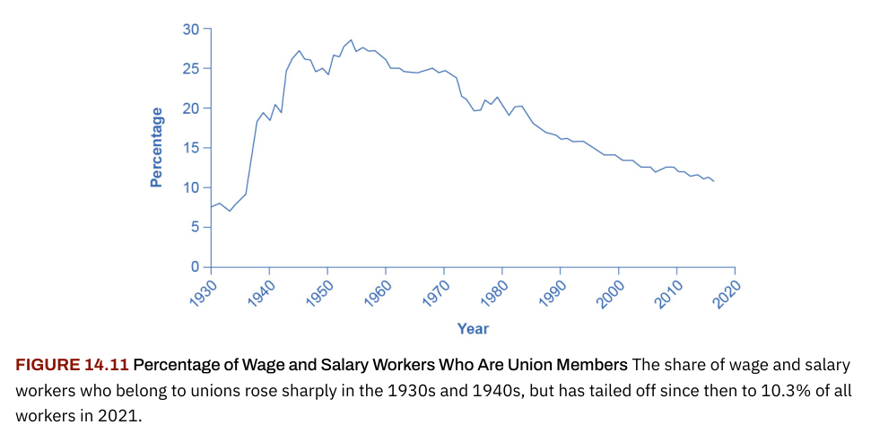

*cited: `p0351-tab14.8` — table Table 14.8 — PDF page 351 (printed 339)*

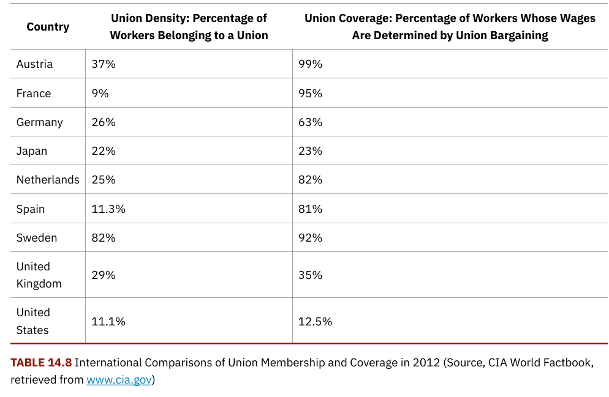

---

## adv-t19 · multihop · draft label: **PASS**

**Question:** In 2020, how did the poverty rate for children under age 18 compare with the overall U.S. poverty rate?

**Expected:** 16.1% for under-18 (Table 15.1) vs 11.4% overall in 2020 (Figure 15.2): 4.7 percentage points higher.

**Agent (answered):** In 2020, the poverty rate for children under age 18 was 16.1%, compared with an overall U.S. poverty rate of 11.4%. Children's rate was about 4.7 percentage points higher (16.1 − 11.4 = 4.7). [p0371-tab15.1] [p0370-t1]

**Draft reason:** 16.1% under-18 (Table 15.1 p.371, viewed) vs 11.4% overall in 2020; the 11.4% is cited to p0370-t1 ('in 2020 ... 37.2 million people living in poverty, representing 11.4%'), equivalent evidence to the Figure 15.2 caption. 16.1 - 11.4 = 4.7.

*cited: `p0371-tab15.1` — table Table 15.1 — PDF page 371 (printed 359)*

*cited: `p0370-t1` — text  — PDF page 370 (printed 358)*

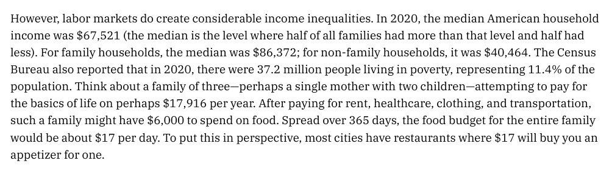

*gold: `p0371-fig15.2` — figure Figure 15.2 — PDF page 371 (printed 359)*

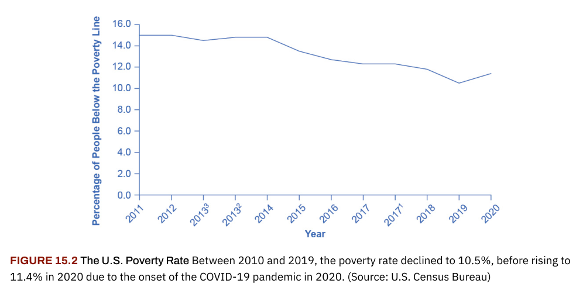

---

## adv-t20 · multihop · draft label: **PASS**

**Question:** How did membership in the United Auto Workers (UAW) change from 1985 to 2021, according to the textbook?

**Expected:** About 975,000 members in 1985 (text, p. 351; roughly 390,000 by 2015) and 408,000 in 2021 (Table 14.6): a fall of about 567,000.

**Agent (answered):** UAW membership fell sharply between 1985 and 2021. The textbook reports it was 975,000 in 1985 and had fallen to roughly 390,000 by 2015 [p0351-t0]. Table 14.6 lists UAW membership at 408,000 in 2021 [p0346-tab14.6]. That is a drop of 975,000 - 408,000 = 567,000 members, or about 58% (567,000 / 975,000 ≈ 0.58).</answer>
<parameter name="citations">["p0351-t0", "p0346-tab14.6"]

**Draft reason:** 975,000 in 1985 (p0351-t0) and 408,000 in 2021 (Table 14.6 p.346, viewed); drop 567,000 (58%) correct; 390,000 by 2015 also in the text. Leaked closing markup in the answer string (formatting glitch).

*cited: `p0351-t0` — text  — PDF page 351 (printed 339)*

*cited: `p0346-tab14.6` — table Table 14.6 — PDF page 346 (printed 334)*

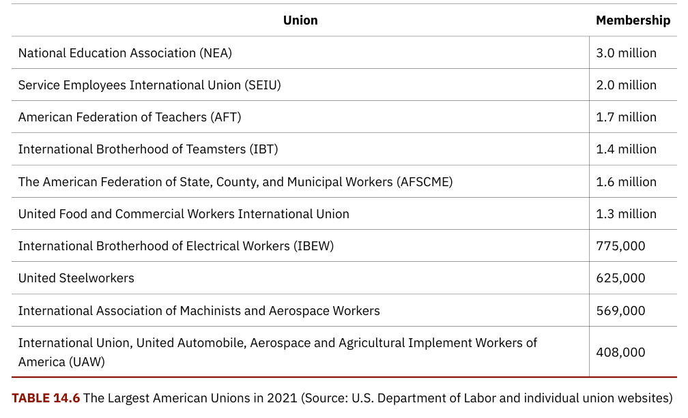

---

## adv-t21 · text · draft label: **PASS**

**Question:** According to the textbook, how does import competition contribute to the decline in union membership, and which unions have continued to grow?

**Expected:** From the 1960s U.S. carmakers and steelmakers faced Japanese and European competition; as imports rose, jobs in these unionized sectors fell, and import competition also reduces unions' bargaining power. Unions that organize public-sector workers, who are not threatened by import competition, have continued to grow.

**Agent (answered):** Import competition contributes to the decline by reducing employment in sectors where unions were once strong, and by weakening unions' bargaining power there. Starting in the 1960s, U.S. carmakers and steelmakers faced growing competition from Japanese and European manufacturers, and as imported cars and steel sold more, U.S. auto manufacturing jobs fell. For example, United Auto Workers membership fell from 975,000 in 1985 to roughly 390,000 by 2015. Unions that organize public-sector workers, who are not threatened by import competition, have continued to grow. The textbook names government-worker unions such as the American Federation of State, County and Municipal Employees (AFSCME), the Service Employees International Union, and the National Education Association as examples. [p0351-t0] [p0350-t2] [p0350-t1]</answer>
<parameter name="citations">["p0351-t0", "p0350-t2", "p0350-t1"]

**Draft reason:** Japanese/European competition from the 1960s, fewer jobs and less bargaining power, public-sector unions still growing (p0350-t2, p0351-t0); union names AFSCME/SEIU/NEA are in cited p0350-t1. Leaked closing markup (formatting glitch).

*cited: `p0351-t0` — text  — PDF page 351 (printed 339)*

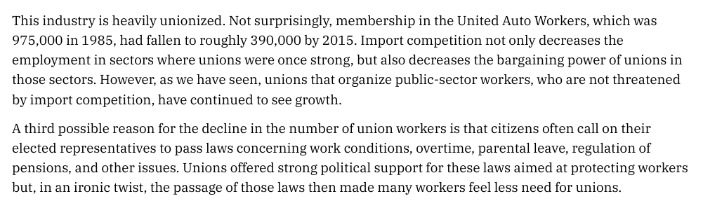

*cited: `p0350-t2` — text  — PDF page 350 (printed 338)*

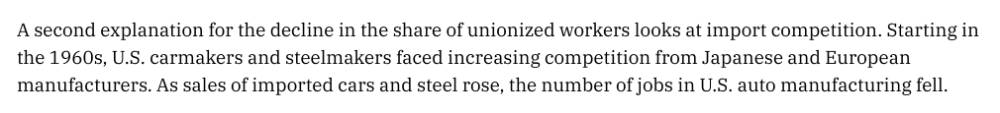

*cited: `p0350-t1` — text  — PDF page 350 (printed 338)*

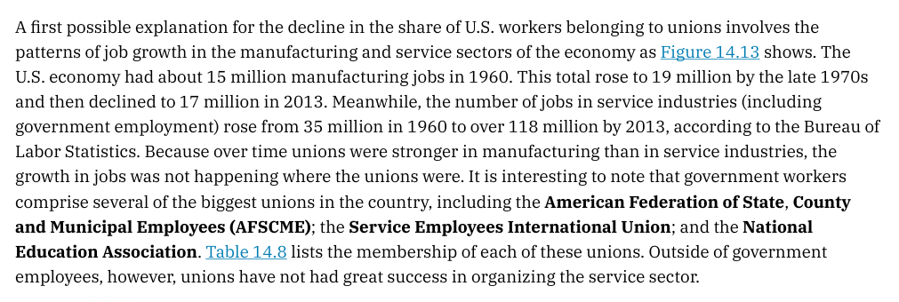

---

## adv-t22 · text · draft label: **PASS**

**Question:** In the lysine price-fixing example, which company was the primary U.S. producer and how large was the lysine industry each year?

**Expected:** Archer Daniels Midland (ADM); a $600 million-a-year industry.

**Agent (answered):** The primary U.S. producer of lysine was Archer Daniels Midland (ADM), though several large European and Japanese firms were also in the market. The lysine industry was worth $600 million a year. [p0261-t1]

**Draft reason:** Archer Daniels Midland, $600 million a year; p0261-t1.

*cited: `p0261-t1` — text  — PDF page 261 (printed 249)*

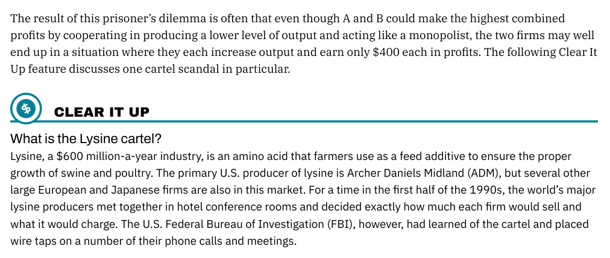

---

## adv-t23 · text · draft label: **PASS**

**Question:** According to the textbook, under what condition do farmers benefit from an agricultural price floor, who pays the costs, and roughly how much do high-income areas spend supporting farmers?

**Expected:** Farmers benefit if the government buys the excess supply (or pays others to buy it); taxpayers and consumers of food pay the costs. High-income areas (U.S., Europe, Japan) spend roughly $1 billion per day supporting farmers.

**Agent (answered):** Farmers benefit from an agricultural price floor if the government is willing to purchase the excess supply (or to provide payments for others to purchase it) [p0085-t3]. Taxpayers and consumers of food pay the costs [p0085-t3]. Economists estimate that high-income areas, including the United States, Europe, and Japan, spend roughly $1 billion per day supporting their farmers [p0085-t3].

**Draft reason:** Condition (government buys excess supply or pays others to), taxpayers and consumers pay, ~$1 billion per day; p0085-t3.

*cited: `p0085-t3` — text  — PDF page 85 (printed 73)*

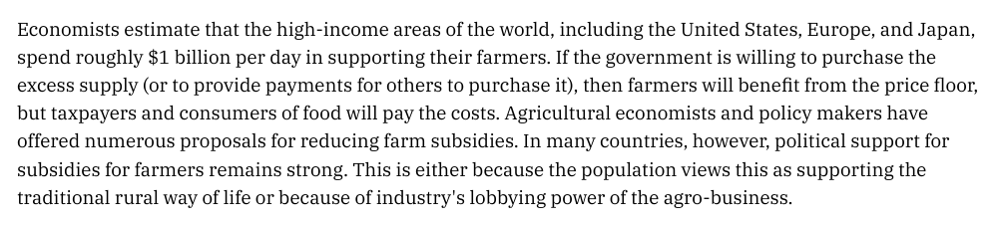

---

## adv-t24 · text · draft label: **PASS**

**Question:** When a perfectly competitive firm is making losses, under what condition should it keep producing in the short run instead of shutting down?

**Expected:** It should keep operating if price (revenue) covers its average variable cost (variable costs), because fixed costs must be paid anyway; if price falls below average variable cost (the shutdown point), it should shut down immediately.

**Agent (answered):** A perfectly competitive firm making losses should keep producing in the short run as long as the market price is above its minimum average variable cost (i.e., above the shutdown point, where MC crosses AVC). In that case, revenue covers at least part of fixed costs, so losses are smaller than shutting down, which would lose all fixed costs. If the price falls below minimum average variable cost, the firm should shut down immediately [p0212-t0]. Equivalently, it should produce where P = MR = MC when price is above AVC at that output, even though price is below average cost [p0221-t3].

**Draft reason:** Keep producing if price is above (minimum) average variable cost / shutdown point, shut down immediately below it; cited p0212-t0 and p0221-t3 state exactly this (equivalent to the listed gold passages).

*cited: `p0212-t0` — text  — PDF page 212 (printed 200)*

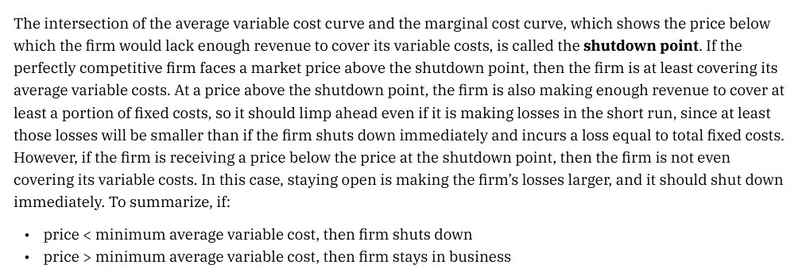

*cited: `p0221-t3` — text  — PDF page 221 (printed 209)*

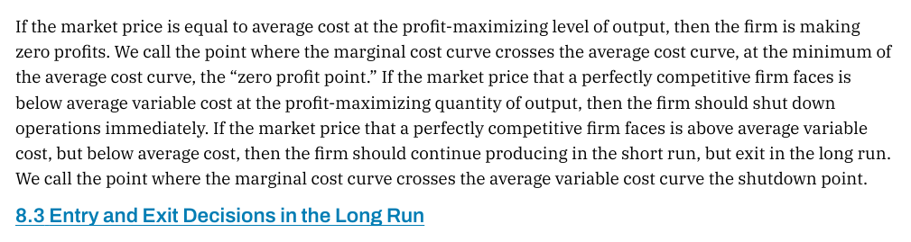

*gold: `p0210-t0` — text  — PDF page 210 (printed 198)*

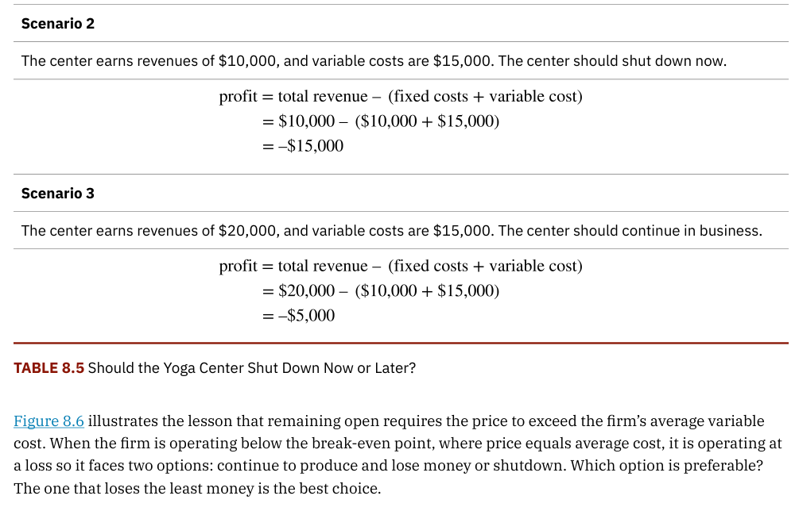

*gold: `p0209-t2` — text  — PDF page 209 (printed 197)*

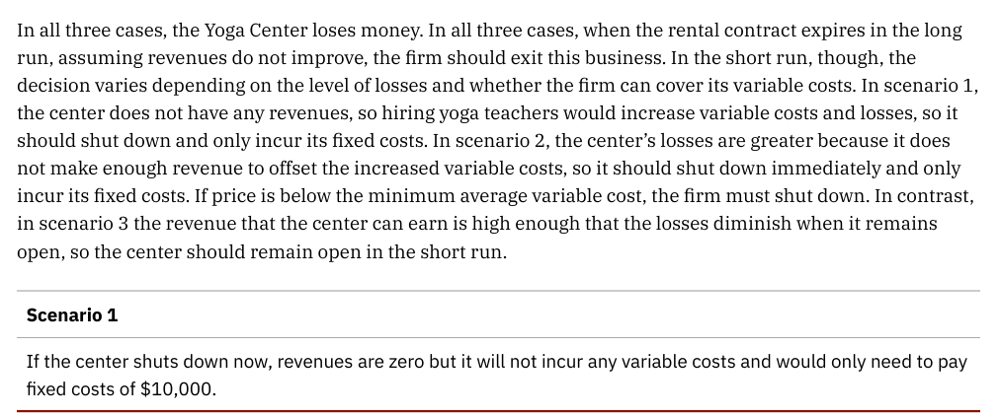

*gold: `p0212-fig8.7` — figure Figure 8.7 — PDF page 212 (printed 200)*

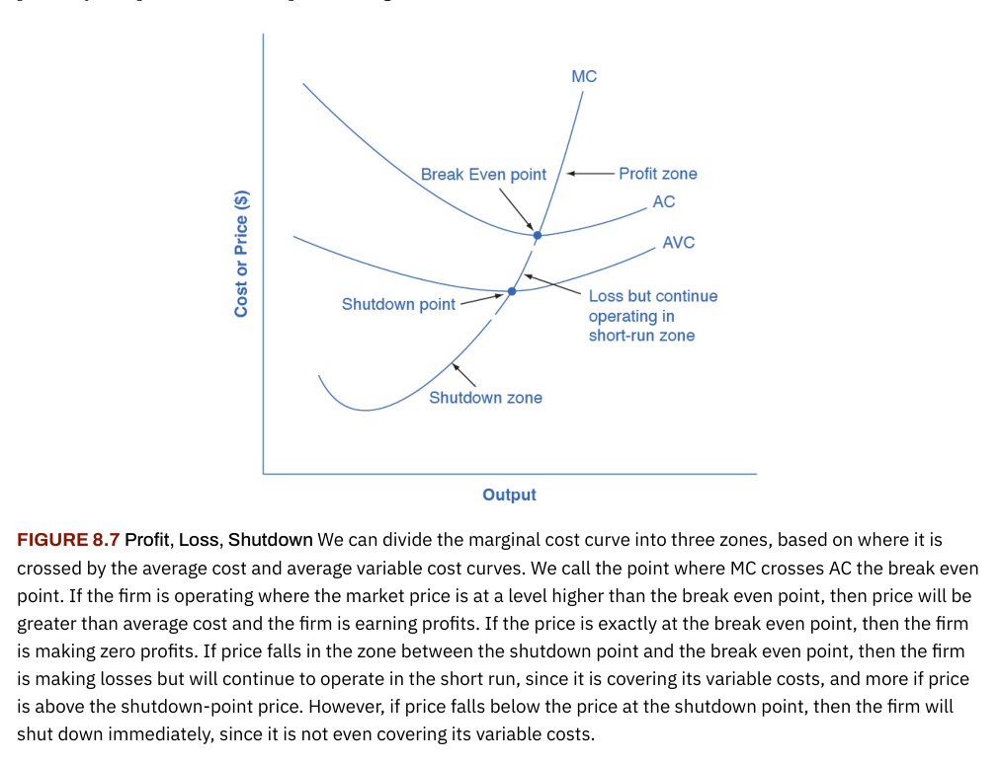

---

## adv-t25 · unanswerable · draft label: **PASS**

**Question:** How many members did the Communications Workers of America have in 2021?

**Expected:** Abstain: the union is not in Table 14.6 or anywhere else in the book.

**Agent (abstain):** Không đủ bằng chứng để trả lời. (Insufficient evidence in the document.)

**Abstain reason:** Table 14.6 (The Largest American Unions in 2021), checked on the page image, lists the top ten unions by membership, and the Communications Workers of America is not among them. A search for the union by name found no other passage giving its membership, so the textbook does not contain the figure asked for.

**How absence was checked:** Table 14.6 checked on the original page; 'Communications Workers' appears nowhere in the indexed text.

**Draft reason:** Abstained after viewing Table 14.6; CWA not listed.

*viewed by agent: `p0346-tab14.6` — table Table 14.6 — PDF page 346 (printed 334)*

---

## adv-t26 · unanswerable · draft label: **PASS**

**Question:** What was the overall U.S. poverty rate in 2021?

**Expected:** Abstain: Figure 15.2 and Table 15.1 stop at 2020; the only 2021 statistic nearby is the share of families headed by single mothers.

**Agent (abstain):** Không đủ bằng chứng để trả lời. (Insufficient evidence in the document.)

**Abstain reason:** The retrieved content gives the U.S. poverty rate only through 2020 (11.4%, Figure 15.2 and the Chapter 14.6 text) and the 2021 poverty line dollar amounts, but does not state the overall poverty rate for 2021.

**How absence was checked:** Regex search for poverty rate with 2021 finds only p384 (single-mother families, 23%), not a poverty rate.

**Draft reason:** Abstained; states data only through 2020, no 2021 rate claimed.

---

## adv-t27 · unanswerable · draft label: **PASS**

**Question:** How many mergers were submitted to the Federal Trade Commission for review in 2016?

**Expected:** Abstain: Figure 11.2(a) covers 1999-2012 only.

**Agent (abstain):** Không đủ bằng chứng để trả lời. (Insufficient evidence in the document.)

**Abstain reason:** The textbook's merger-submission data (Figure 11.2a) covers only 1999 to 2012. The retrieved content contains no figure or statement giving the number of mergers submitted to the FTC in 2016.

**How absence was checked:** Figure 11.2 axis ends at 2012; the text on p.273 gives no 2016 count.

**Draft reason:** Abstained; Figure 11.2(a) covers 1999-2012.

---

## adv-t28 · unanswerable · draft label: **PASS**

**Question:** What was health care spending per person in Japan in 2020?

**Expected:** Abstain: Table 16.2 lists only the U.S., Germany, France, Canada and the U.K.

**Agent (abstain):** Không đủ bằng chứng để trả lời. (Insufficient evidence in the document.)

**Abstain reason:** The retrieved Table 16.2 (2020 health care spending per person) covers only the United States, Germany, France, Canada, and the United Kingdom. Japan does not appear in it, and no other retrieved content gives Japan's health care spending per person for 2020.

**How absence was checked:** Table 16.2 checked on the original page; no 'Japan' near 'health' anywhere.

**Draft reason:** Abstained after viewing Table 16.2; Japan not listed.

*viewed by agent: `p0409-tab16.2` — table Table 16.2 — PDF page 409 (printed 397)*

---

## adv-t29 · unanswerable · draft label: **PASS**

**Question:** What was the total annual return on S&P 500 stocks in 2022?

**Expected:** Abstain: Table 17.2 ends with 2021 (28.71%).

**Agent (abstain):** Không đủ bằng chứng để trả lời. (Insufficient evidence in the document.)

**Abstain reason:** The textbook's S&P 500 return data (Table 17.2) covers only 1950–1959 through 2021, with no figure for 2022. The retrieved content does not include the 2022 total annual return, so I cannot answer without outside knowledge.

**How absence was checked:** Table 17.2 last row is 2021; 2022 mentions in the book (Netflix, Facebook prices, gold) are not S&P returns.

**Draft reason:** Abstained; Table 17.2 ends in 2021.

---

## adv-t30 · unanswerable · draft label: **PASS**

**Question:** How many patents were granted in the United States in 2021?

**Expected:** Abstain: Figure 13.4 ends in 2020.

**Agent (abstain):** Không đủ bằng chứng để trả lời. (Insufficient evidence in the document.)

**Abstain reason:** The only patent-count data in the retrieved content is Figure 13.4 (Patents Filed and Granted, 1990–2020), which ends in 2020. It does not give the number of patents granted in 2021, so I cannot answer without outside knowledge.

**How absence was checked:** Figure 13.4 axis ends at 2020; no patent counts for 2021 in the text.

**Draft reason:** Abstained; Figure 13.4 ends in 2020.

---
